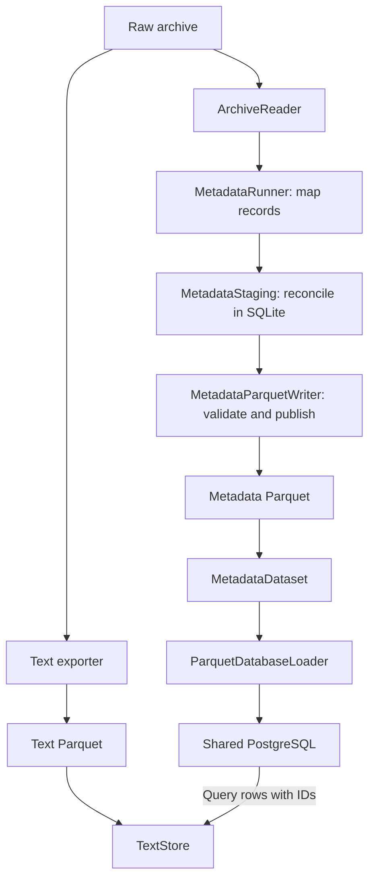

# Data pipeline guides

Run commands from the repository root: the directory containing `README.md`,
`requirements.txt`, and `project/`. The examples use `./project/venv/bin/python`;
an activated environment with the requirements installed works too.

| Goal | Component | Short guide |
| --- | --- | --- |
| Inspect one raw JSON discussion | `ArchiveReader` | [Readers](READERS.md#archivereader-raw-json) |
| Inspect prepared metadata without the raw archive | `MetadataDataset` | [Readers](READERS.md#metadatadataset-prepared-rows) |
| Attach original text to SQL results | `TextStore` | [Readers](READERS.md#textstore-local-text) |
| Prepare metadata Parquet from the archive | `MetadataRunner` | [Runners](RUNNERS.md#prepare-metadata) |
| Rebuild the separate text release | `export_text_parquet.py` | [Text export](PARQUET.md) |
| Import prepared metadata into PostgreSQL | `ParquetDatabaseLoader` | [Runners](RUNNERS.md#import-metadata-into-postgresql) |
| Verify an existing import | Read-only live tests | [Runners](RUNNERS.md#verify-an-import) |

## How the pieces fit

Post/comment IDs join the two releases. The metadata release contains relational
columns, labels, and memberships; it retains `posts.title` under the current
schema. The separate text release supplies original titles/bodies. Their index
formats differ: metadata has per-table file lists; text has a post file and one
comment file per discussion. Point each reader at the matching release.

`CommentStaging` and `MetadataStaging` are local extraction helpers, not team
databases. Missing referenced parents become unavailable placeholders. Full
discussion metadata takes precedence over task fallbacks. Identity lookups and
parent-reference indexes avoid unnecessary updates and growing table scans.

For analysis, use PostgreSQL queries plus `TextStore`; rebuilding the archive or
reimporting metadata is unnecessary. Start with the [team download guide](../../../TEAM_DATA.md).

## More detail

- [Preparation internals and arguments](../parquet_loaders/README.md).
- [Database merge/transaction rules](../db_loaders/README.md).
- [Test commands and opt-in live checks](../../tests/README.md).
- The component modules include constructor, method, return-value, and resource
  ownership docstrings for use in the IDE or Python's `help()`.
