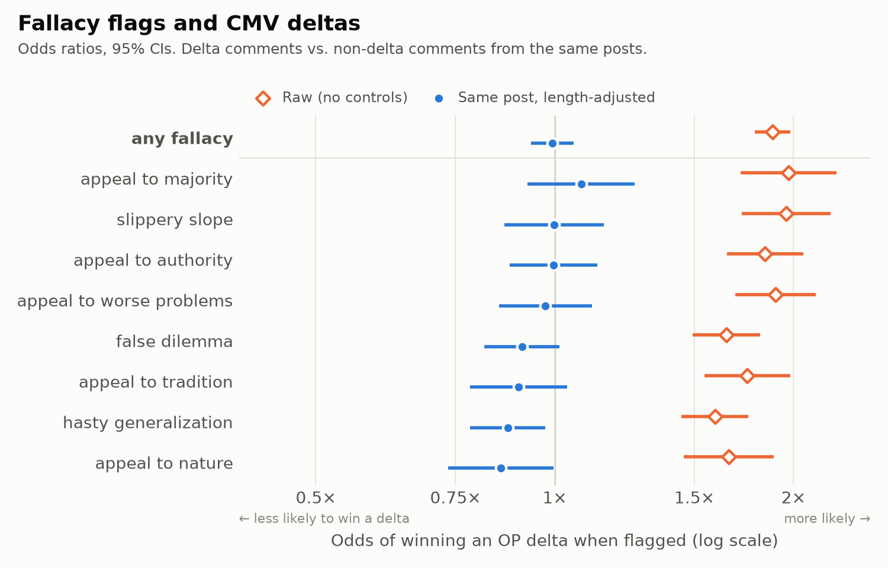

# Fallacy flags vs. CMV deltas

Does a comment the fallacy model flags win an OP delta more or less often?

**Short answer: no detectable relationship once length is accounted for.** Raw,
every fallacy flag goes with ~1.6–2× higher odds of a delta, but that is
because longer comments are both flagged more and awarded more. Comparing
comments in the same post at the same length, every odds ratio is ~1.



## Data setup

Put the two team downloads here (both paths are git-ignored):

| File | Where | Used for |
|---|---|---|
| `cmv-text.zip` | unzip into `project/data/processed/` → `project/data/processed/cmv-text/v1/` | comment text via `TextStore` |
| `cmv.tar.bz2` | `project/data/raw/cmv.tar.bz2`, then `tar -xjf cmv.tar.bz2 all pair_task op_task README` inside `project/data/raw/` | authors, parents, DeltaBot replies |

```bash
unzip -n ~/Downloads/cmv-text.zip -d project/data/processed/
cp ~/Downloads/cmv.tar.bz2 project/data/raw/
(cd project/data/raw && tar -xjf cmv.tar.bz2 all pair_task op_task README)
.venv/bin/python -c "from cmv_data import TextStore; print(TextStore('project/data/processed/cmv-text/v1').validate())"
```

The text export holds only IDs and text, so delta labels come from the raw
archive (no database login needed).

## Pipeline

```bash
# 1. comment-level delta labels (~40 s) -> project/data/processed/cmv-deltas/comments.parquet
.venv/bin/python project/notebooks/fallacy-analysis/build_comment_deltas.py

# 2. score a matched sample with the fallacy model (~15 min on an M4, resumable)
.venv/bin/python project/notebooks/fallacy-analysis/score_comments.py

# 3. statistics + figure -> results/ and figures/
.venv/bin/python project/notebooks/fallacy-analysis/analyze_fallacy_delta.py
```

1. **Delta labels.** For each DeltaBot "Confirmed: 1 delta awarded to /u/X"
   reply, the awarding comment is its parent and the delta-winning comment is
   the parent of that, kept when its author is X (or was later deleted).
   10,099 of 10,112 confirmations link, giving 7,491 comments with an
   OP-awarded delta (`got_delta_op`) and 9,255 with a delta from anyone.
2. **Sample.** Eligible comments are not by the OP or a bot, not deleted, with
   ≥ 20 words outside quotes (824k comments, 0.87% with an OP delta). The sample
   takes all 7,155 eligible OP-delta comments plus up to 5 random non-delta
   comments from the same post: 40,954 comments in 4,780 posts.
3. **Scoring.** Quoted (`>`) lines are removed, since a quote's fallacies are
   the quoted person's. Text is split into windows of up to 3 sentences
   (stride 2, median 44 words, close to the training length) and each window
   gets calibrated probabilities. A comment is flagged for a fallacy if any window
   has P ≥ 0.5. Per-window rows (with text, useful for highlighting) are in
   `windows/`, per-comment aggregates in `comments/`.
4. **Analysis.** Conditional (fixed-effects) logistic regression grouped by
   post, so each delta comment is compared only with comments on the same post,
   controlling for log length. Holm-corrected across the 9 tests.

## Results (`results/fallacy_delta_univariate.csv`)

| | Flagged, delta | Flagged, no delta | Raw OR | Adjusted OR [95% CI] | Holm p |
|---|---|---|---|---|---|
| **any fallacy** | 49% | 34% | 1.88 | 0.99 [0.93, 1.06] | 1.00 |
| appeal to majority | 4.0% | 2.1% | 1.97 | 1.08 [0.93, 1.26] | 1.00 |
| slippery slope | 4.7% | 2.5% | 1.96 | 1.00 [0.86, 1.16] | 1.00 |
| appeal to authority | 6.3% | 3.6% | 1.84 | 1.00 [0.88, 1.13] | 1.00 |
| appeal to worse problems | 5.7% | 3.1% | 1.90 | 0.97 [0.85, 1.11] | 1.00 |
| false dilemma | 8.1% | 5.1% | 1.65 | 0.91 [0.82, 1.02] | 0.63 |
| appeal to tradition | 4.9% | 2.9% | 1.75 | 0.90 [0.78, 1.04] | 0.87 |
| hasty generalization | 8.2% | 5.3% | 1.59 | 0.87 [0.78, 0.97] | 0.13 |
| appeal to nature | 4.4% | 2.7% | 1.66 | 0.86 [0.73, 1.00] | 0.36 |

Point-biserial correlations between the model score and the delta label are
small (r = 0.05–0.14) and are the raw, length-confounded association.

Why length explains it (delta rate within the sample, by length quartile):

| Length quartile | Flag rate | Delta rate, not flagged | Delta rate, flagged |
|---|---|---|---|
| Q1 (shortest) | 18% | 5.3% | 5.7% |
| Q2 | 27% | 9.7% | 11.1% |
| Q3 | 39% | 18.8% | 18.7% |
| Q4 (longest) | 62% | 33.9% | 37.0% |

**Robustness.** The null holds at flag thresholds 0.7 and 0.9, with
length-decile dummies instead of log length (all ORs 0.91–1.03, every CI
crossing 1), with a length-robust "share of windows flagged" measure (all
p > 0.08), and in a joint model with all 8 flags (`results/fallacy_delta_joint.csv`).
The slight negative effects for hasty generalization and appeal to nature
under log length shrink to ~0.93 and ~0.91 with decile controls, so they look
like leftover length confounding.

## Caveats

- **Measurement noise.** The model scores 0.60 macro-F1 on real Reddit text
  (0.77 overall) and flags 38% of CMV comments, which looks like over-flagging.
  Noisy flags pull associations toward 1, so this rules out large effects of
  *the model's flags*, not of fallacies themselves. A hand-labelled CMV sample
  would tell us how much.
- **Within-post design.** Effects that operate between posts (e.g. fallacies
  being more common in posts whose OP never awards a delta) are differenced out
  by design.
- **Associational.** No causal claim; comments differ in many other ways
  (timing, depth, author reputation).

For the delta classifier, this suggests fallacy flags add little beyond
length. They may still matter in interaction with other features or as
per-window highlights in the visualization.
